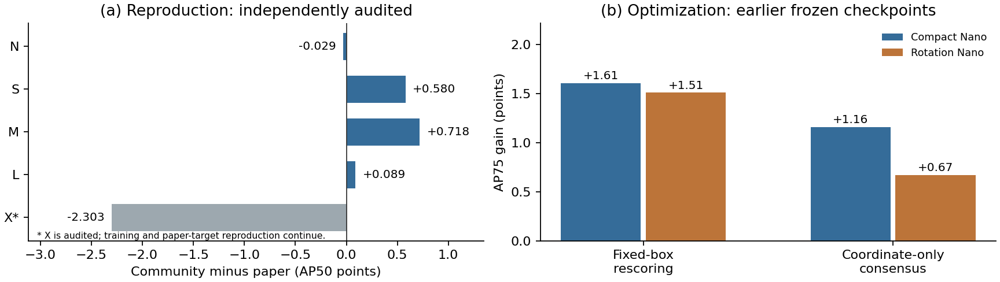

# OpenRiO

**A community reproduction of RiO-DETR, with auditable checkpoints and practical improvements.**

[](https://doi.org/10.13140/RG.2.2.16995.11040) [](LICENSE) [](requirements.txt)

English · [简体中文](README.zh-CN.md)

[Technical report PDF](report/main.pdf) · [Report on ResearchGate](https://www.researchgate.net/publication/415911327_OpenRiO_A_Community_Reproduction_of_RiO-DETR_with_Practical_Accuracy_and_Efficiency_Improvements) · [Model cards](docs/MODEL_CARDS.rst) · [Optimization guide](docs/OPTIMIZATION_GUIDE.rst) · [Evaluation protocol](docs/PROTOCOL.rst) · [Citation](CITATION.cff)

**Zhicheng Du · Lan Ma (corresponding author)**  
Tsinghua Shenzhen International Graduate School, Tsinghua University

OpenRiO has two goals: reproduce competitive rotated object detection models, then improve their accuracy and execution on fixed checkpoints. We release the models together with the evaluation conventions, training-state lessons and controls needed to understand their results. The original detector and method credit belongs to the [RiO-DETR authors](https://arxiv.org/abs/2603.09411); this is an independent community project based on their [official repository](https://github.com/RicePasteM/RiO-DETR).

> **Preview v0.1.0-preview.7 · 16 October 2026.** N/S/M/L checkpoints, prediction, complete DIOR-R evaluation and useful optimization recipes are available in the prepared release. X, FAIR1M and DOTA are ongoing. Portable end-to-end training and independent detector seeds are still pending.

This lean preview keeps one report PDF, four user guides and consolidated experiment records. Intermediate report files and superseded snapshots are omitted; model/runtime bytes match preview.6.



*Left: audited reproduction endpoints at the evening evidence cut; X is ongoing. Right: improvements on earlier frozen Nano sources, with separate controls for score ordering and geometry. These deltas are not added to the latest reproduction scores. [Figure values](logs/mechanism_checks.json).* 

## Reproduction results

**Complete DIOR-R test split: 11,738 images, single model, single view, uncalibrated EMA, rotated VOC2007 eleven-point AP50 (%).**

| Model | Parameters | Paper AP50 | OpenRiO AP50 | Difference | Checkpoint |
| :--- | ---: | ---: | ---: | ---: | :--- |
| N | 4.01 M | 71.920 | **71.891** | −0.029 | `n.pth` |
| S | 8.27 M | 74.440 | **75.020** | +0.580 | `s.pth` |
| M | 19.21 M | 75.730 | **76.448** | +0.718 | `m.pth` |
| L | 28.10 M | 76.110 | **76.199** | +0.089 | `l.pth` |

Each endpoint passed fresh full-test inference and independent polygon-matching/AP verification. The table retains the recorded training-run endpoints; fresh audit differences are below 0.001 AP point. Exact values, source states and digests are in [models.json](models.json). Tested continuation recipes reached empirical plateaus; this is not a claim of global convergence.

**Scope matters.** These are community recipes, with the public five-coordinate Nano path and a disclosed compact four-coordinate S/M/L reconstruction. Each path has one training ancestry. Repeated test feedback informed selection, and the standard split contains 23 audited byte-identical cross-split images. Close scores do not establish identical author training, unbiased generalization or independent-seed replication. See the [protocol](docs/PROTOCOL.rst) and [model cards](docs/MODEL_CARDS.rst).

## Improvements on fixed models

The release includes useful methods and the baseline controls needed to evaluate them. Every comparison uses its own frozen source; historical optimization sources are separate from the primary models above.

| Improvement | Matched result | Cost or scope |
| :--- | :--- | :--- |
| Small: multi-view ranking and weighted geometry | AP50 **73.982 → 76.465** | Five forwards; historical Small source |
| Medium: multi-view ranking and uniform geometry | AP50 **74.790 → 77.512** | Five forwards; historical Medium source |
| Nano: normalization calibration with training images | AP50 **71.803 → 71.978** | Two layers, 256 recorded training images; its own parent |
| N/S: source-anchored online adaptation | AP50 **+0.688 / +0.743** | Specified synthetic-noise streams; parameter updates |
| Nano: CUDA Graph execution | Median **34.17 → 30.36 ms** | Paired shared-device byte-to-CPU timing; declared exclusions |

The multi-view methods also include both Nano paths and fixed-box rescoring controls. CUDA Graph retained full-set boxes and logits bitwise in the research check; shared-device latency is contextual, not a hardware-independent speed guarantee. Clean-domain adaptation declined. Online AP belongs to the prediction trajectory, **not static inference from the final parameter snapshot**. Fresh portable full-stream runs also passed: N/S gained **+0.727 / +0.775 AP50** over the retained matched frozen controls. These are reruns of the same trained sources, not new detector seeds; the original table above remains a distinct recorded experiment. See the [completed validation receipt](logs/optimizations.json).

[Commands and exact comparisons →](docs/OPTIMIZATION_GUIDE.rst)

## Quick start

Use **Python 3.10**. The tested environment uses PyTorch **2.9.1** and torchvision **0.24.1**; select the appropriate CUDA/CPU build for your machine.

```bash
python -m pip install torch==2.9.1 torchvision==0.24.1
python -m pip install -r requirements.txt
```

### Get the model assets

The **full release archive** includes ten tensor-only detector weights and two stream-specific adaptation snapshots. The **source archive** omits these tensors. If using source only, obtain the companion assets from the maintainer and preserve this layout:

```text
OpenRiO/
├── README.md
├── openrio.py
├── models.json
├── configs/
├── weights/       # detector .pth files
└── adapters/      # terminal adaptation .pth files and metadata
```

Primary references are `n`, `s`, `m` and `l`. `n_calibrated` is an optimization result; the four `*_multiview` models and `n_calibration_parent` bind comparisons to their exact historical sources. The adapter files are parameter snapshots, not standalone detectors. The detector weights and adapter snapshots are distributed as GitHub Release assets rather than in the repository; download them from the Releases page and place them using the layout above.

With all companion assets in place, verify their identity:

```bash
python tools/verify_release.py
```

### Predict and evaluate

Predict a square image tile:

```bash
python openrio.py predict --model m --image /path/to/square-tile.jpg \
  --device cuda:0 --output outputs/m-example
```

Evaluate the complete DIOR-R test set:

```bash
CUDA_VISIBLE_DEVICES=0 python openrio.py evaluate --model l \
  --data-root /path/to/DIOR-R --output outputs/l-full \
  --batch-size 1 --workers 2 --memory-fraction 0.18
```

Independently check the saved predictions:

```bash
python tools/independent_eval.py --data-root /path/to/DIOR-R \
  --predictions outputs/l-full/predictions.pt \
  --native-metrics outputs/l-full/metrics.json \
  --output outputs/l-independent
```

Use the [documented dataset layout](docs/PROTOCOL.rst). Each output directory must be new; run one model per process. `--limit` is diagnostic and suppresses AP. Arbitrary-image letterbox inversion is not validated. The CUDA memory fraction limits the process allocator; it does not reserve memory against other jobs.

### Run an accuracy or speed improvement

```bash
# Five-view Small evaluation: exact source of the reported 76.465 AP50 result.
python optimize.py evaluate --model s_multiview --method weighted \
  --data-root /path/to/DIOR-R --device cuda:0 --output outputs/s-weighted

# Paired eager / CUDA Graph timing and output checks.
python benchmark.py --model n --data-root /path/to/DIOR-R \
  --device cuda:0 --output outputs/n-graph
```

Calibration, N/S adaptation, frozen controls and separate scoring commands are in the [optimization guide](docs/OPTIMIZATION_GUIDE.rst).

## What we learned

- **Model state is part of the recipe.** EMA, normalization statistics, optimizer history and continuation schedules affect the endpoint; matching a configuration alone is insufficient.
- **Coverage, confidence and localization need separate controls.** Fixed-box rescoring and coordinate-only interventions distinguish useful candidates from their ranking and geometric precision.
- **An improvement has a scope.** Benefits can differ across model sizes and domain shifts. Accuracy, adaptation and execution results require their own sources, costs and controls.

The [technical report](report/main.pdf) develops these observations and mechanisms. Failed attempts, alternate explanations and boundaries remain in its discussion and appendices; failed deployment recipes and experimental weights are not part of the recommended release. Broader YOLO transfer evidence is discussed in the report, but a supported multi-framework model zoo is still pending.

## In progress / Coming soon

Status is a dated release snapshot, not a promise of final scores or completion dates.

| Deliverable | Status |
| :--- | :--- |
| DIOR-R N/S/M/L | **Available:** audited checkpoints, inference and complete evaluation |
| Useful optimization recipes | **Available:** multi-view inference, calibration, adaptation and graph benchmarking |
| DIOR-R X | **In progress:** best 75.127 AP50; independent full-test audit 75.126; continuation and training-state controls ongoing; X weights not included |
| FAIR1M-2.0 M/X | **In progress:** training, scene/patch evaluation and paper-protocol reconciliation |
| DOTA-1.0 | **In progress:** training/export; official-server scores pending |
| Portable multi-stage training | **In preparation:** installation-to-export validation pending |
| Three independent detector seeds | **Planned:** not yet completed or represented by continuation seeds |
| Broader model integrations | **Exploratory:** transfer evidence exists; complete reproduction suites are not released |

See the [dated research snapshot](logs/research_status.json) and [recorded training settings](docs/RECIPE_STATUS.rst).

The latest completed X window ends at **75.067 AP50**, below its retained best; the next plateau-confirmation window is running. FAIR-M epoch 32 reaches **40.480 scene / 34.877 patch AP50**, under protocols not yet equated to the paper. New target-normalization and physical-batch controls await their first full evaluations. The [dated snapshot](logs/research_status.json) separates these running trials from released endpoints.

## Documentation and evidence

| Resource | Contents |
| :--- | :--- |
| [Model cards](docs/MODEL_CARDS.rst) | Model ancestry, configuration, EMA state and selection |
| [Evaluation protocol](docs/PROTOCOL.rst) | Dataset layout, angles, difficulty and independent metric check |
| [Optimization guide](docs/OPTIMIZATION_GUIDE.rst) | Runnable methods, source weights, controls and restrictions |
| [Technical report](report/main.pdf) | Reproduction, mechanisms, improvements and failure analysis |
| [Evidence](logs/) | Full-set evaluation, identity checks and retained continuation observations |
| [Upload guide](UPLOAD_GUIDE.rst) | Repository-root layout and separate release assets |

Retained continuation curves are not a fabricated full from-scratch training history. The report is a working technical-report draft, not an arXiv submission or peer-reviewed publication.

## Credit, citation and license

Please credit [RiO-DETR](https://arxiv.org/abs/2603.09411) for the original detector and cite this versioned community artifact for its reproduction, analysis and engineering contributions. Citation metadata is in [CITATION.cff](CITATION.cff).

To cite the code and evidence records:

```bibtex
@software{du2026openrio,
  author       = {Du, Zhicheng and Ma, Lan},
  title        = {OpenRiO: A Community Reproduction of RiO-DETR with
                  Practical Accuracy and Efficiency Improvements},
  version      = {0.1.0-preview.7},
  month        = {10},
  year         = {2026},
  institution  = {Tsinghua Shenzhen International Graduate School,
                  Tsinghua University},
  url          = {https://github.com/dodoxxb/OpenRiO}
}
```

To cite the written report, also published on [ResearchGate](https://www.researchgate.net/publication/415911327_OpenRiO_A_Community_Reproduction_of_RiO-DETR_with_Practical_Accuracy_and_Efficiency_Improvements):

```bibtex
@techreport{du2026openrioreport,
  author      = {Du, Zhicheng and Ma, Lan},
  title       = {OpenRiO: A Community Reproduction of RiO-DETR with
                 Practical Accuracy and Efficiency Improvements},
  month       = {10},
  year        = {2026},
  doi         = {10.13140/RG.2.2.16995.11040},
  institution = {Tsinghua Shenzhen International Graduate School,
                 Tsinghua University},
  url         = {https://www.researchgate.net/publication/415911327_OpenRiO_A_Community_Reproduction_of_RiO-DETR_with_Practical_Accuracy_and_Efficiency_Improvements}
}
```

Source code is covered by [Apache-2.0](LICENSE), with upstream attribution in [NOTICE.txt](NOTICE.txt). Weight terms and report-image terms are documented separately in [WEIGHTS_NOTICE.txt](WEIGHTS_NOTICE.txt) and the notices. Dataset images and annotations are not bundled.

Contact: [Zhicheng Du](mailto:duzc21@mails.tsinghua.edu.cn) · [Lan Ma](mailto:malan@sz.tsinghua.edu.cn).

New report figures connect public-baseline / community examples, fixed-source geometric improvement and counterexamples, and full-set diagnostic distributions. [Figure values and selection records](logs/mechanism_checks.json).
